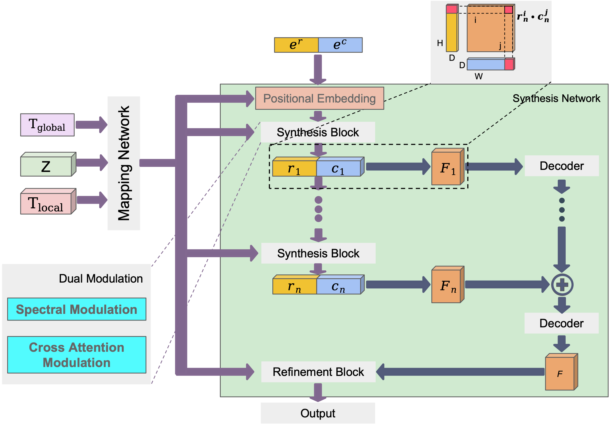
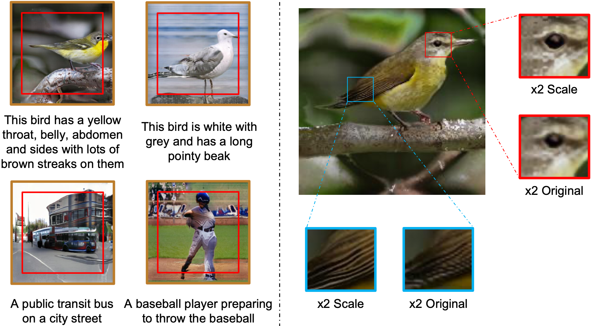

# Extending Implicit Neural Representations for Text-to-Image Generation
<a href="https://doi.org/10.1109/ICASSP48485.2024.10446171"></a>
<a href="./LICENSE"></a>

Guanming Liu,
Zhihua Wei,
Heng Zhang,
Rui Wang,
Aiquan Yuan,
Chuanbao Liu,
Biao Chen,
Guodong Cao<br>
Tongji University, Alibaba Group

> **Abstract:**
Implicit neural representations (INRs) have demonstrated their effectiveness in continuous modeling for image signals. However, INRs typically operate in a continuous space, which makes it difficult to integrate the discrete symbols and structures inherent in human language. To address this, we propose **EIDGAN**, an efficient scale-invariant dual-modulated GAN that extends INRs for text-to-image generation while balancing representation power and computation cost. EIDGAN combines spectral modulation for global sentence conditioning and cross-attention modulation for local word conditioning. Benefiting from a column-row entangled bi-line design, the model supports text-guided generation of any-scale images and semantic extrapolation beyond image boundaries.





Details of the model architecture and experimental results can be found in [our paper](https://doi.org/10.1109/ICASSP48485.2024.10446171).

```bibtex
@inproceedings{liu2024extending,
  title={Extending Implicit Neural Representations for Text-to-Image Generation},
  author={Liu, Guanming and Wei, Zhihua and Zhang, Heng and Wang, Rui and Yuan, Aiquan and Liu, Chuanbao and Chen, Biao and Cao, Guodong},
  booktitle={2024 IEEE International Conference on Acoustics, Speech and Signal Processing (ICASSP)},
  year={2024},
  pages={7520--7524},
  doi={10.1109/ICASSP48485.2024.10446171}
}
```

**Please CITE** this paper whenever the code or model design helps produce published results or derivative software.

##### Table of contents
1. [Requirements](#requirements)
2. [Getting Started](#getting-started)
3. [Using Networks from Python](#using-networks-from-python)
4. [Preparing Datasets](#preparing-datasets)
5. [Training](#training)
6. [Quality Metrics](#quality-metrics)
7. [Model Checkpoints](#model-checkpoints)
8. [Acknowledgements](#acknowledgements)

## Additional material

- This repository is a **minimal open-source migration** that keeps the core EIDGAN training, sampling, and evaluation path.
- Public model checkpoints are provided separately through Google Drive.
- This release does **not** include notebooks, internal shell scripts, experiment logs, or the full paper PDF.
- The README figures are cropped from the published ICASSP 2024 paper for repository presentation.
- Related upstream projects:
  - [CREPS](https://github.com/thuanz123/creps)
  - [StyleGAN3](https://github.com/NVlabs/stylegan3)
  - [StyleGAN2-ADA PyTorch](https://github.com/NVlabs/stylegan2-ada-pytorch)

## Requirements

* Linux is recommended. The code relies on custom CUDA extensions in [`torch_utils/`](./torch_utils).
* NVIDIA GPU(s) are required for actual training and normal generation workloads.
* Python 3.8+ with compatible PyTorch, torchvision, and CUDA.
* Python libraries are listed in [`requirements.txt`](./requirements.txt) and [`environment.yml`](./environment.yml).
* You can create the environment with:
  - `conda env create -f environment.yml`
  - `conda activate eidgan`

## Getting Started

The public release keeps a single public model option: `--cfg=eidgan`.

Generate images from a trained checkpoint:

```bash
python gen_images.py --network=/path/to/network-snapshot.pkl \
    --outdir=out --text="a public transit bus on a city street" --seeds=0-3
```

Outputs are written to `out/*.png`, controlled by `--outdir`.

The generation script also keeps the interpolation and extrapolation controls used in the paper:

```bash
python gen_images.py --network=/path/to/network-snapshot.pkl \
    --outdir=out --text="this bird is white with grey and has a long pointy beak" \
    --seeds=2 --mode=extrapolation --height=1.0
```

Method-specific controls:

- `--text`: text prompt used to extract both sentence-level and token-level CLIP features for dual modulation.
- `--seeds`: random seeds for latent sampling.
- `--mode`: `interpolation` or `extrapolation`, matching the two controls highlighted in Fig. 3 of the paper.
- `--height`: spatial extent of the queried coordinate region. Increasing it enlarges the sampled region and is useful for beyond-boundary extrapolation.
- `--startpoints`: a list of coordinate offsets used to query multiple coordinate windows from the same continuous image field.
- `--starth` / `--startw`: starting offsets for a single queried region.

Current generation behavior:

- Without `--startpoints`, `gen_images.py` renders a single queried window controlled by `--starth` and `--startw`.
- With `--startpoints`, the script renders one fixed-resolution window per start point, saves every tile separately, and also writes a `combined-seedXXXX-...png` preview image.
- The current `combined` image is a simple row-major mosaic of cropped tiles. It is intended as a lightweight stitched preview, not as a geometry-aware compositor.
- In other words, the public script currently supports multi-window tiled generation, but not true single-pass dense-grid upsampling.

Typical EIDGAN controls from the paper:

```bash
# Larger-field, scale-consistent interpolation shown as a 2x tiled preview.
python gen_images.py --network=/path/to/network-snapshot.pkl \
    --outdir=out --text="a baseball player preparing to throw the baseball" \
    --seeds=2 --mode=interpolation --height=1.0 \
    --startpoints="(0.0,0.0),(0.0,0.5),(0.5,0.0),(0.5,0.5)"

# Beyond-boundary extrapolation around a prompt-aligned region.
python gen_images.py --network=/path/to/network-snapshot.pkl \
    --outdir=out --text="This bird has a yellow throat, belly, abdomen and sides with lots of brown streaks on them" \
    --seeds=2 --mode=extrapolation --height=1.0 \
    --startpoints="(-0.5,-0.5),(-0.5,0.5),(0.5,-0.5),(0.5,0.5)"
```

Practical note:

- For larger outputs in the current public release, prefer tiled generation via `--startpoints`.
- Each tile keeps the original queried coordinate count and shifts the queried window instead of increasing the token count in one forward pass.
- If you need a geometry-aware final stitch, treat the saved per-tile images as the primary output and adapt the compositor to your window layout.

## Using Networks from Python

You can load a trained checkpoint in Python as follows:

```python
import dnnlib
import legacy
import torch

with dnnlib.util.open_url("network-snapshot.pkl") as f:
    G = legacy.load_network_pkl(f)["G_ema"].cuda()

z = torch.randn([1, G.k, G.z_dim], device="cuda")
c = torch.zeros([1, G.c_dim], device="cuda")
```

For text-conditioned synthesis, EIDGAN also requires sentence-level and token-level CLIP features. See [`gen_images.py`](./gen_images.py) for the complete inference path.

## Preparing Datasets

`training.dataset.TextImgDataset` expects a text-image dataset directory with the following layout:

```text
data/<dataset_name>/
├── train/
│   └── filenames.pickle
├── test/
│   └── filenames.pickle
├── text/
│   ├── <sample_id>.txt
│   └── ...
├── images/
│   ├── train2014/
│   ├── val2014/
│   └── ...
└── CUB_200_2011/
    ├── images/
    ├── bounding_boxes.txt
    └── images.txt
```

Dataset-specific notes:

- **MS-COCO**:
  - training images: `images/train2014`
  - test images: `images/val2014`
  - captions: `text/<sample_id>.txt`
- **CUB**:
  - images: `CUB_200_2011/images/<sample_id>.jpg`
  - captions: `text/<sample_id>.txt`
  - bird bounding boxes are read from `bounding_boxes.txt`

In both cases, `train/filenames.pickle` and `test/filenames.pickle` should contain the sample ids without file extensions.

Update [`configs/dataset/coco.yml`](./configs/dataset/coco.yml) or [`configs/dataset/birds.yml`](./configs/dataset/birds.yml) so that `data_dir` points to your local dataset root.

## Training

You can train EIDGAN using [`train.py`](./train.py). For example:

```bash
# Train EIDGAN on MS-COCO.
python train.py --cfg=eidgan --outdir=training-runs \
    --multigpus=False --hydra_cfg_name=eidgan.yml \
    --dataset_cfg_name=dataset/coco.yml

# Train EIDGAN on CUB.
python train.py --cfg=eidgan --outdir=training-runs \
    --multigpus=False --hydra_cfg_name=eidgan.yml \
    --dataset_cfg_name=dataset/birds.yml
```

The training loop exports network pickles (`network-snapshot-<KIMG>.pkl`) and image snapshots at regular intervals. It can also compute evaluation metrics during training depending on `--metrics`.

## Quality Metrics

By default, the public release keeps the EIDGAN evaluation path centered on FID and CLIP-based text-image metrics.

```bash
# Evaluate a trained checkpoint on a local dataset directory.
python calc_metrics.py --metrics=fid50k_full,clipsim \
    --network=/path/to/network-snapshot.pkl --data=/path/to/dataset/root
```

Available metrics:

* `fid50k_full`: Frechet inception distance against the full dataset.
* `clipsim`: CLIP similarity between generated images and prompts.
* `clipRprecision`: CLIP-R precision on generated images.
* `clipRprecisionTrue`: CLIP-R precision on the real dataset.

## Model Checkpoints

Public EIDGAN network checkpoints are available at:

- [Google Drive folder](https://drive.google.com/drive/folders/17Rh3vkbpXLLx-0jPdqWwPDzfv77bxdXJ?usp=sharing)

After downloading, pass the local `.pkl` path to `--network`.

Example usage:

```bash
# Generate images from a downloaded checkpoint.
python gen_images.py --network=/path/to/network-snapshot.pkl \
    --outdir=out --text="a bird with a yellow belly and a short beak" --seeds=0-3

# Run tiled interpolation / extrapolation with the downloaded checkpoint.
python gen_images.py --network=/path/to/network-snapshot.pkl \
    --outdir=out --text="a baseball player preparing to throw the baseball" \
    --seeds=2 --mode=interpolation --height=1.0 \
    --startpoints="(0.0,0.0),(0.0,0.5),(0.5,0.0),(0.5,0.5)"

# Evaluate a downloaded checkpoint.
python calc_metrics.py --metrics=fid50k_full,clipsim \
    --network=/path/to/network-snapshot.pkl --data=/path/to/dataset/root
```

## Acknowledgements

This release preserves substantial infrastructure derived from earlier CREPS / StyleGAN-style training code. Original copyright and license notices in the source files are retained.

Relevant upstream repositories:

- [CREPS](https://github.com/thuanz123/creps)
- [StyleGAN3](https://github.com/NVlabs/stylegan3)
- [StyleGAN2-ADA PyTorch](https://github.com/NVlabs/stylegan2-ada-pytorch)

## License

This repository is released under [Apache-2.0](./LICENSE).
